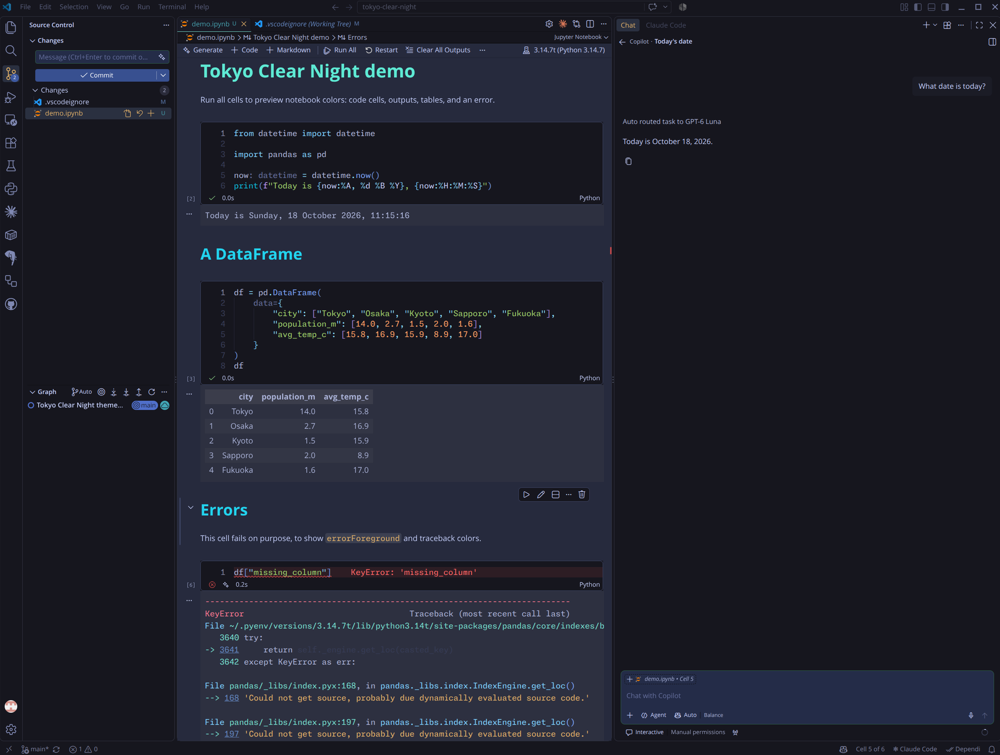
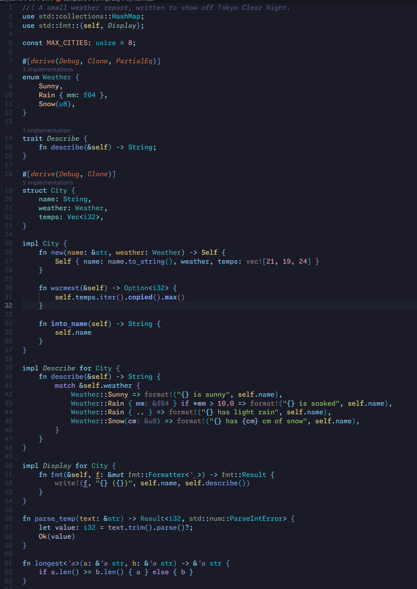

# Tokyo Clear Night

[Tokyo Night](https://github.com/tokyo-night/tokyo-night-vscode-theme) with brighter UI chrome: readable sidebar, tabs, menus and breadcrumbs, teal (`#73daca`) highlights, clearer list selections, and lighter notebook pages behind darker cells.

**Tailored for Python and Rust.** Both languages get their own syntax colors on top of Tokyo Night, using semantic highlighting from Pylance and rust-analyzer so that tokens with different roles look different.



### Rust

Traits are italic sea-mist, attributes rust orange, `self` and `Self` light gold, macros taupe, and methods that consume `self` are bold.



## Building

The theme is generated from the installed Tokyo Night extension plus `overrides.jsonc`:

```sh
python3 build.py
npx @vscode/vsce package
```

`python3 make_python_demo.py` regenerates `python_demo.ipynb`, a notebook showing every Python element with its color. Update its tables when you change Python colors in `overrides.jsonc`. `python3 make_rust_demo.py` does the same for Rust (`rust_demo.ipynb`); it needs VS Code with rust-analyzer.

## License

MIT. Based on Tokyo Night by Enkia (MIT).
